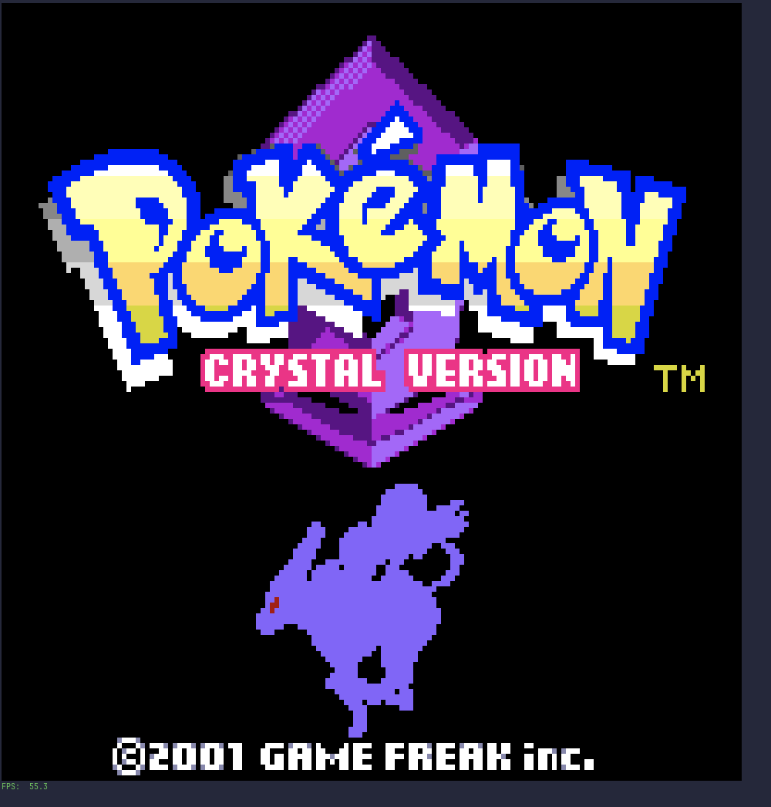
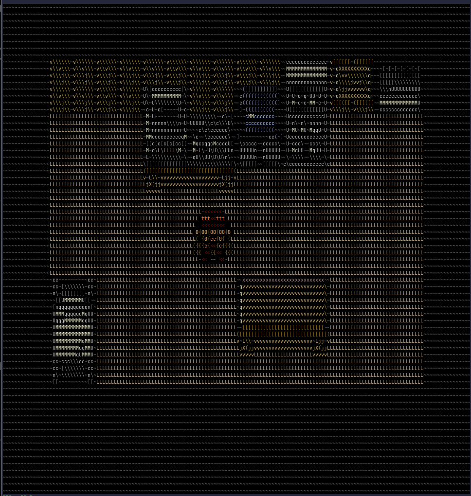
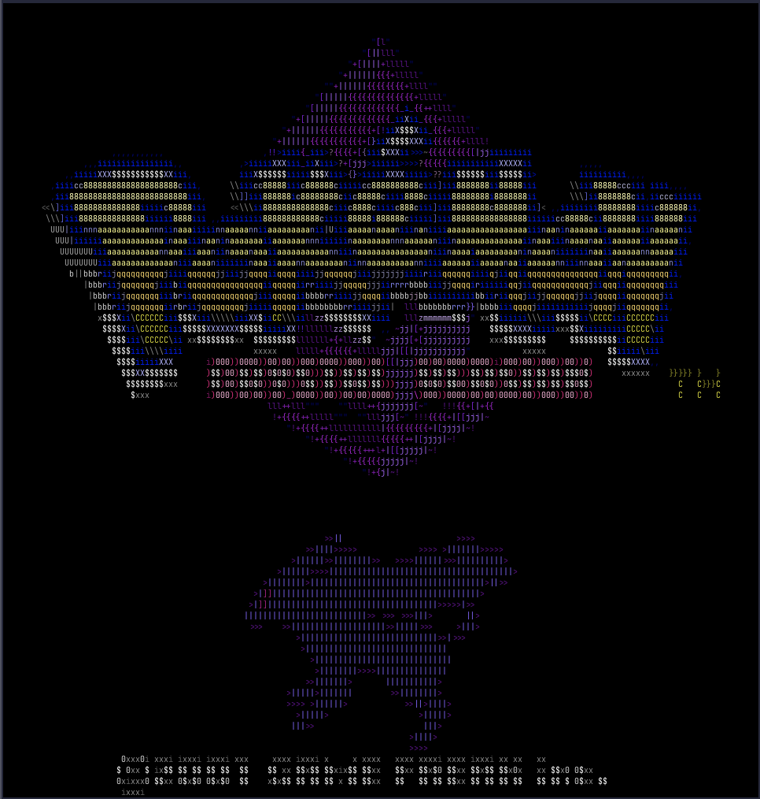
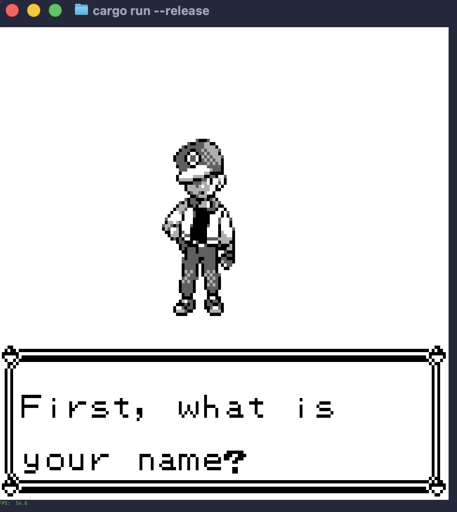

# Terminal GameBoy

A rust, terminal-based Game Boy and Game Boy Color emulator with ASCII art and block rendering modes. Play your favorite retro games right in your terminal!

Utilizes [gameboy_core](https://crates.io/crates/gameboy_core) for the emulator, providing input & output directly to the emulator.

## Demo

<video src="media/terminal_gameboy.mp4" autoplay loop muted playsinline></video>



## Features

- **Two rendering modes:**
  - **ASCII mode** — Classic ASCII art using brightness characters
  - **Block mode** — Unicode half-block characters for higher fidelity
- **Audio support** — Full sound emulation via rodio
- **Save states** — Automatic save/load for games with battery backup
- **Interactive menu** — ROM browser when launched without arguments
- **Cross-platform** — Works on macOS, Linux, and Windows

## Installation

### From crates.io

```bash
cargo install terminal_gameboy
```

### From source

```bash
git clone https://github.com/dquigles/terminal_gameboy.git
cd terminal_gameboy
cargo build --release
```

The binary will be at `target/release/terminal_gameboy`.

## Usage

### Interactive Mode

Simply run without arguments to get an interactive ROM browser:

```bash
terminal_gameboy
```


### Command Line

```bash
terminal_gameboy <rom_file.gb> [OPTIONS]
```

#### Options

| Flag      | Description                                         |
| --------- | --------------------------------------------------- |
| `--ascii` | ASCII art mode with brightness characters (default) |
| `--block` | Unicode block mode with solid half-blocks           |
| `--mute`  | Disable audio output                                |
| `--help`  | Show help message                                   |

### Examples

```bash
# Run with ASCII rendering (default)
terminal_gameboy pokemon.gb

# Run with block rendering
terminal_gameboy pokemon.gb --block

# Run without sound
terminal_gameboy pokemon.gb --mute
```

#### Rendering Modes

**ASCII Mode** — uses brightness characters for a classic terminal look:





**Block Mode** — uses Unicode half-blocks for higher fidelity:



## Controls

| Key        | Action   |
| ---------- | -------- |
| Arrow keys | D-Pad    |
| Z          | A button |
| X          | B button |
| Enter      | Start    |
| Space      | Select   |
| Q / Esc    | Quit     |

## Terminal Requirements

For the best experience:

- Use a terminal with **true color support** (24-bit color)
- A **monospace font** is required
- Recommended terminal size: **162×74** or larger
- Terminals with keyboard release event support (Ghostty, Kitty, WezTerm) provide better input handling

### Tested Terminals

| Terminal         | Status                                      |
| ---------------- | ------------------------------------------- |
| Ghostty          | ✅ Excellent                                |
| Kitty            | ✅ Excellent                                |
| WezTerm          | ✅ Excellent                                |
| iTerm2           | ✅ Good                                     |
| Terminal.app     | ⚠️ Unplayable, block mode has weird tearing |
| Windows Terminal | ✅ Good                                     |

## ROM Files

This emulator requires Game Boy (`.gb`) or Game Boy Color (`.gbc`) ROM files. You must provide your own legally obtained ROM files.

## Save Files

Save files are automatically stored in a `.saves/` directory next to the ROM file. The emulator automatically loads saves on startup and saves on exit.

## License

MIT License — see [LICENSE](LICENSE) for details.

## Acknowledgments

Built with:

- [gameboy_core](https://crates.io/crates/gameboy_core) — Game Boy emulation
- [crossterm](https://crates.io/crates/crossterm) — Terminal handling
- [rodio](https://crates.io/crates/rodio) — Audio playback
