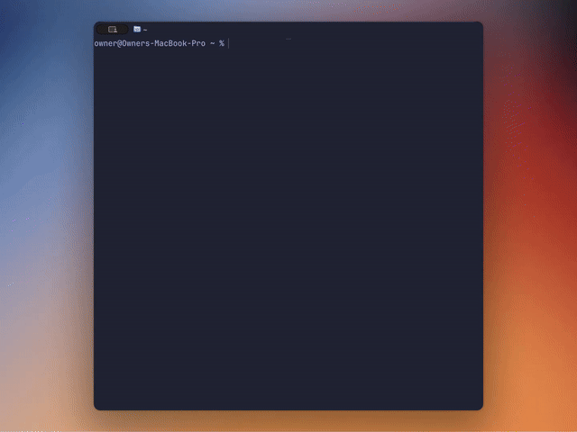
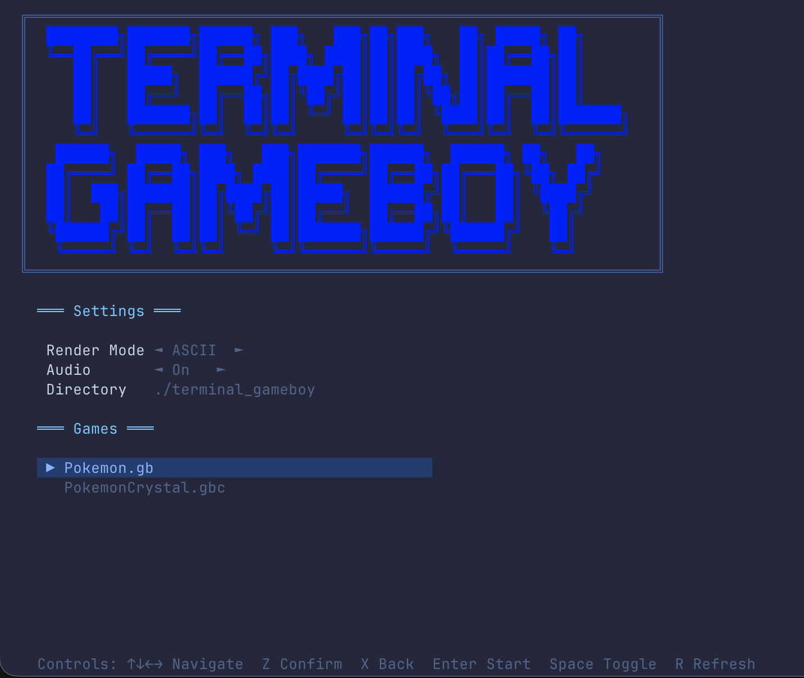

# Vostok Gameboy

> A fork of [terminal_gameboy](https://github.com/dquigles/terminal_gameboy) by Dillon Quigley, being rebuilt as a Vostok terminal app.
> The backend is described in [MAP.md](MAP.md); current state and limits are in [CONTEXT.md](CONTEXT.md).
> The screenshots below are from the original app.

A rust, terminal-based Game Boy and Game Boy Color emulator with ASCII art and block rendering modes. Play your favorite retro games right in your terminal!

The emulator itself is [gameboy_core](https://crates.io/crates/gameboy_core), kept in `core/` with save states added (see `core/README.md`).

## Demo




## Features

- **Two rendering modes:**
  - **ASCII mode** — Classic ASCII art using brightness characters
  - **Block mode** — Unicode half-block characters for higher fidelity
- **Audio support** — Full sound emulation via rodio
- **Battery saves** — Automatic save/load for games with battery backup
- **Save states** — Four slots per game, each a snapshot of the whole machine with a preview picture
- **Interactive menu** — ROM browser when launched without arguments
- **Cross-platform** — Works on macOS, Linux, and Windows

## Installation

```bash
cargo build --release
```

The binary will be at `target/release/vostok-gameboy`.

## Usage

### Interactive Mode

Simply run without arguments to get an interactive ROM browser:

```bash
vostok-gameboy
```



### Command Line

```bash
vostok-gameboy <rom.gb | rom.gbc | rom.zip> [OPTIONS]
```

#### Options

| Flag      | Description                                         |
| --------- | --------------------------------------------------- |
| `--ascii` | ASCII art mode with brightness characters (default) |
| `--block` | Unicode block mode with solid half-blocks           |
| `--mute`  | Disable audio output                                |
| `--palette NAME` | Colours for four-shade games: grey, dmg, pocket, phosphor, amber |
| `--help`  | Show help message                                   |

### Examples

```bash
# Run with ASCII rendering (default)
vostok-gameboy pokemon.gb

# Run with block rendering
vostok-gameboy pokemon.gb --block

# Run without sound
vostok-gameboy pokemon.gb --mute
```

#### Rendering Modes

**ASCII Mode** — uses brightness characters for a classic terminal look:


**Block Mode** — uses Unicode half-blocks for higher fidelity:


## Controls

| Key               | Action          |
| ----------------- | --------------- |
| Arrow keys / WASD | D-Pad           |
| Z / K             | A button        |
| X / J             | B button        |
| Enter             | Start           |
| Backspace / Space | Select          |
| P                 | Pause           |
| Tab               | Turbo on / off  |
| Q / Esc           | Quit (saves)    |

Keys are set in the `[keys]` table of `~/.config/vostok-gameboy/config.toml`.

## JSON command line

For scripts and agents; see `vostok-gameboy ctl help`.

```bash
vostok-gameboy ctl dirs add ~/Games
vostok-gameboy ctl list
vostok-gameboy ctl run Tetris.zip --frames 600 --press start@300 --shot tetris.png
vostok-gameboy ctl run Tetris.zip --frames 600 --save-state 1
vostok-gameboy ctl run Tetris.zip --load-state 1 --frames 60
vostok-gameboy ctl states Tetris.zip
vostok-gameboy ctl palette Tetris.zip amber
```

## Terminal Requirements

For the best experience:

- Use a terminal with **true color support** (24-bit color)
- A **monospace font** is required
- Recommended terminal size: **162×74** or larger
- Terminals with keyboard release event support (Ghostty, Kitty, WezTerm) provide better input handling

### Tested Terminals

| Terminal         | Status                                      |
| ---------------- | ------------------------------------------- |
| Ghostty          | ✅ Excellent                                |
| Kitty            | ✅ Excellent                                |
| WezTerm          | ✅ Excellent                                |
| iTerm2           | ✅ Good                                     |
| Terminal.app     | ⚠️ Unplayable, block mode has weird tearing |
| Windows Terminal | ✅ Good                                     |

## ROM Files

This emulator requires Game Boy (`.gb`) or Game Boy Color (`.gbc`) ROM files, loose or inside a `.zip`. You must provide your own legally obtained ROM files.

## Save Files

Games with a battery save to `~/.config/vostok-gameboy/saves/<rom name>.sav` (a standard `.sav`). The save is
written shortly after the game saves, when you pause, and on exit; the previous file is kept as `.sav.bak`.
Saves from the original app (`.saves/` next to the ROM) are picked up automatically.

Save states are separate: `~/.config/vostok-gameboy/states/<rom id>/slot<N>.state`, four slots per game. They
only load into this app, and only into the game they were made with.

## License

MIT License — see [LICENSE](LICENSE) for details.

## Acknowledgments

Built with:

- [gameboy_core](https://crates.io/crates/gameboy_core) by Ben Konz — Game Boy emulation (Apache-2.0, copied into `core/`)
- [crossterm](https://crates.io/crates/crossterm) — Terminal handling
- [rodio](https://crates.io/crates/rodio) — Audio playback
